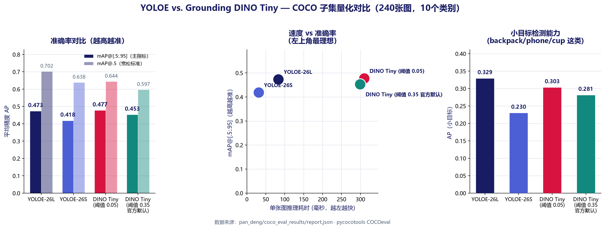
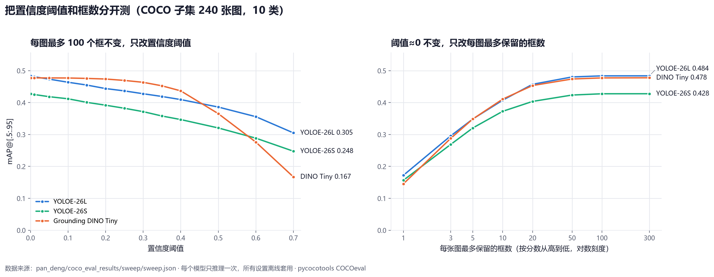
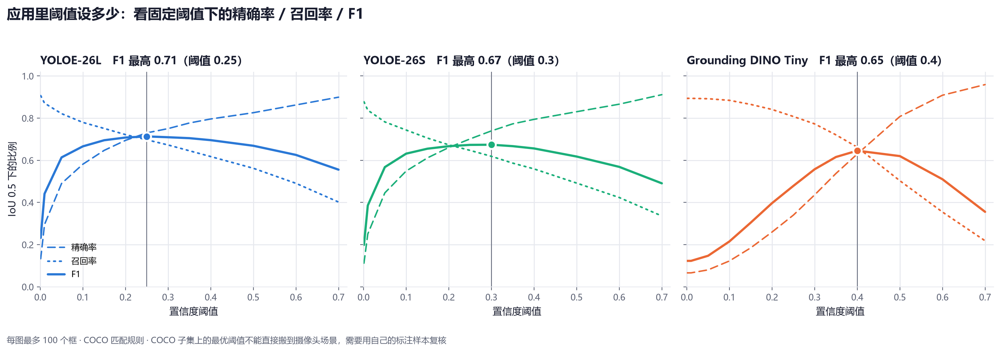

# Quantitative comparison: YOLOE vs. Grounding DINO Tiny

First labelled accuracy evaluation for this project. Earlier validation runs (see
`../../validation/grounding_dino_preview/` and the rest of `../../validation/`) checked
that things work and how fast they run; this one scores real detections against real
ground-truth boxes. This folder (`pan_deng/`) holds the evaluation tooling and results
Pan Deng added.

## Method

- **Data**: 240 images from COCO val2017, selected (round-robin, not just the first N)
  so all ten target classes are represented, with their official instance annotations.
  Not the full 5,000-image split — see `../download_coco_subset.py`.
- **Classes**: `person, bicycle, car, dog, backpack, bottle, cup, chair, laptop,
  cell phone` — ten common COCO categories, chosen to overlap with the app's own demo
  prompts. This is *not* a test of either model's full open-vocabulary range, only of
  these ten words.
- **Models**: YOLOE-26L, YOLOE-26S, and Grounding DINO Tiny, each given the same ten
  class names as its text prompt and scored with `pycocotools.cocoeval.COCOeval`
  (`bbox` mode) — the same tool and metric definitions (mAP@[.5:.95], mAP@.5, AR) used
  in standard detection benchmarks, so these numbers are directly comparable to ones
  reported elsewhere.
- **Confidence threshold**: 0.05 for every model (low on purpose, so COCOeval's own
  precision-recall sweep is not truncated). Grounding DINO Tiny is also run at its
  documented default of 0.35 for comparison. `sweep/` below separates the threshold
  from the number of boxes kept per image.
- **Grounding DINO class labels** come from each class's own prompt tokens: every
  query gets one score per class (the highest probability among that class name's
  tokens) and takes the best class. See "Correction" below for why.
- Run with `../evaluate_detectors.py`; full per-detection output kept alongside
  `report.json` for auditability.

## Results

| Model | mAP@[.5:.95] | mAP@.5 | ms/image | Detections |
| --- | ---: | ---: | ---: | ---: |
| YOLOE-26L | 0.473 | **0.702** | 83 | 3,475 |
| YOLOE-26S | 0.418 | 0.638 | **31** | 3,592 |
| Grounding DINO Tiny (threshold 0.05) | **0.478** | 0.644 | 310 | 39,070 |
| Grounding DINO Tiny (threshold 0.35, its own default) | 0.453 | 0.597 | 299 | 2,574 |

Full COCOeval breakdown — AP/AR by IoU strictness and by object size. AP@.75 needs a
tighter box match than AP@.5:

| Model | AP@.75 | AP small | AP medium | AP large | AR@100 | AR small | AR medium | AR large |
| --- | ---: | ---: | ---: | ---: | ---: | ---: | ---: | ---: |
| YOLOE-26L | 0.492 | **0.329** | 0.560 | 0.659 | 0.585 | 0.417 | 0.667 | 0.762 |
| YOLOE-26S | 0.434 | 0.230 | 0.529 | 0.583 | 0.534 | 0.321 | 0.636 | 0.704 |
| DINO Tiny (0.05) | **0.514** | 0.303 | **0.573** | **0.723** | **0.673** | **0.488** | **0.752** | **0.844** |
| DINO Tiny (0.35) | 0.490 | 0.281 | 0.541 | 0.713 | 0.566 | 0.375 | 0.636 | 0.815 |

(`AP`/`AR small|medium|large` follow COCO's own area buckets: small <32², medium
32²–96², large >96² pixels.) Latency is a single run on an RTX 5060 Laptop GPU and
moves by roughly 15% between runs (YOLOE-26L measured 67–83 ms/image across runs).

## Correction: the earlier Grounding DINO numbers were a labelling bug

The first version of this report gave Grounding DINO Tiny 0.132 mAP at threshold 0.05
and 0.414 at 0.35, and blamed the drop on "too many duplicate low-score boxes". That
explanation was wrong. The engine passed `text_threshold=min(conf, 0.30)` to the
Hugging Face post-processor, so lowering the box threshold also lowered the text
threshold. Each box then matched several class words at once (a label such as
`person bicycle car`), and the substring lookup that followed always picked the class
listed first. Cups, bottles and chairs were scored as people and cars.

Scoring the same detections with every label replaced by one class shows the boxes
were fine all along:

| Threshold | mAP before fix | mAP after fix | Class-agnostic mAP (before → after) |
| --- | ---: | ---: | ---: |
| 0.05 | 0.132 | **0.478** | 0.503 → 0.504 |
| 0.35 | 0.414 | **0.453** | 0.468 → 0.468 |

`GroundingDinoEngine.detect` in `../../engines.py` now scores each class by its own
prompt tokens, so the label no longer depends on the threshold. The app's Grounding
DINO backend uses the same code. The pre-fix detections and report are kept in
`legacy_text_threshold/` so the table above can be reproduced.

## Threshold and box budget, tested separately (`sweep/`)

Lowering the threshold also raises the number of boxes per image, so the first
comparison could not say which of the two mattered. `../sweep_threshold_topk.py` runs
each model once at threshold 0.001 (at most 300 boxes per image), then applies every
setting offline to those same detections:

- **Threshold sweep**: box budget fixed at 100 per image, threshold 0.001–0.7.
- **Box-budget sweep**: threshold fixed at 0.001, keep the top 1–300 boxes per image.

- **More boxes never lowered mAP.** With the threshold held near zero, mAP rises with
  the box budget and levels off by about 50 boxes per image (YOLOE-26L 0.480 at 50,
  0.484 at 300). Too *few* boxes is what hurts: at 10 per image every model loses
  0.06–0.08.
- **A higher threshold always lowers mAP**, because mAP already sweeps every score
  cutoff itself. Grounding DINO holds flat up to about 0.3 and then falls fastest
  (0.437 at 0.4, 0.167 at 0.7): its scores bunch in a narrow band, so the same
  threshold means something different for each model.

mAP ranks detections and does not pick an operating point. The app's confidence
slider does, so the sweep also reports precision, recall and F1 at IoU 0.5 for the
detections each threshold keeps:

| Model | Best-F1 threshold | Precision | Recall | F1 | Boxes/image |
| --- | ---: | ---: | ---: | ---: | ---: |
| YOLOE-26L | 0.25 | 0.730 | 0.697 | **0.713** | 8.0 |
| YOLOE-26S | 0.30 | 0.739 | 0.619 | 0.674 | 6.9 |
| Grounding DINO Tiny | 0.40 | 0.630 | 0.662 | 0.645 | 8.2 |

These are the best points on this COCO subset; camera footage needs its own labelled
check before fixing the app's defaults.

## What this shows

- **YOLOE-26L and Grounding DINO Tiny are level on mAP** (0.473 vs 0.478 — too close
  to separate on 240 images). They differ in kind: DINO Tiny fits boxes more tightly
  (AP@.75 0.514 vs 0.492) and is stronger on large objects and recall; YOLOE-26L is
  stronger at AP@.5 and on small objects (0.329 vs 0.303).
- **At a single working threshold YOLOE-26L is ahead** (best F1 0.713 vs 0.645), and it
  is about 4× faster (83 vs 310 ms/image). YOLOE-26S is about 10× faster than DINO Tiny
  at 0.418 mAP, which keeps it the default for real-time video.
- **Grounding DINO Tiny still beats YOLOE-26S on small objects** (AP small 0.303 vs
  0.230), which supports keeping it as the open-vocabulary fallback.
- **Small objects are the hardest case for every model**: AP small is half of AP large
  or less for all three. That is the scenario the app's small-object tiling exists for.

## Limits

- Ten common classes only, not a test of open-vocabulary phrases like "red backpack"
  or attribute-level queries — COCO's category labels don't support that.
- One fixed IoU=0.45 for NMS on both engines; not swept.
- Single run per configuration, no repeated-seed variance estimate.
- 240 images is a deliberately small, fast-to-reproduce subset, not the full COCO
  val2017 split; per-class AP with this few examples per class is noisier than a
  full-split evaluation.
- COCOeval keeps at most 100 boxes per image per class, so the 300-box setting in the
  sweep only differs from 100 when one class has more than 100 candidates.
